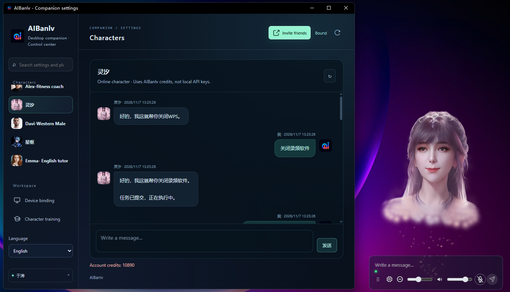

[简体中文](README.md) · [繁體中文](README.zh-Hant.md) · [English](README.en.md) · [日本語](README.ja.md)

# AIBanlv Bot

**An expressive desktop companion that talks, acts, and keeps you updated.**

Give it a task by voice or text. Harness connects computer tools and agents such as Codex and WorkBuddy, while your 3D companion brings public progress and results back to your desktop. An interface for work, and a companion between tasks.

[Download for Windows / Mac](https://aibanlv.ai/zh?view=desktop-companion) · [Bot capabilities](#bot-capabilities) · [Video demos](#video-demos) · [Ask AI to install](#ask-ai-to-install-it) · [Community](#community)

> Project highlight: expressive 3D avatars rendered locally in real time, with no dedicated GPU required.



## Bot capabilities

| Capability | Put your Bot to work |
| --- | --- |
| **Computer use** | Built-in Harness coordinates search, reading and local computer tools to execute tasks |
| **Agent orchestration** | Assign tasks to installed, signed-in Codex / WorkBuddy, follow public progress and results, and optionally hear updates |
| **Phone control** | Send remote tasks after App binding, and transfer screenshots or specified files to your bound phone |
| **3D voice companion** | A transparent desktop avatar with expressions, lip sync, voice, text and mouse-touch interaction |
| **Characters and memory** | Customize characters; local personas and records live in `SOUL.md`, `MEMORY.md` and daily conversation documents |
| **Reminders and email** | Scheduled reminders, notification readout and read-only email checks, with optional summaries and body excerpts |
| AI Advisory Council | A proactive AI advisory system: based on everyday interactions, AI initiates discussions and finds solutions. |

## From a request to a result

1. **Give it a goal:** type, speak, or send a task from your bound phone.
2. **Use the tools:** Harness routes tasks to configured computer tools or external agents.
3. **Follow the outcome:** view live information below the avatar and enable spoken progress or completion reports.

```text
Research the AI companion market and summarize the findings with sources.
Ask Codex to review this project and report the results when done.
Take a screenshot and send it to my bound phone.
```

Harness is embedded, or you can connect a signed-in Harness client using the [connector plugin](demos/web-desktop-pet/harness-client-plugin/README.md). Install and sign in to Codex or WorkBuddy separately. Tools and file transfers depend on available capabilities and granted permissions; only public progress and results are shown, not hidden reasoning. See [permissions and local data](docs/CLIENT_SECURITY.md).

## Video demos

### Touch interaction

https://github.com/user-attachments/assets/52426b81-48d8-462e-9196-fe106cceb57c

### Control your computer by voice

https://github.com/user-attachments/assets/80ee7c5e-2ab5-46c9-b0d1-9954af03df63

## Download

Download, choose a character and mode, then enable the AI tools you need. Source setup and first-use configuration are in the [installation guide](docs/INSTALL_FOR_AGENTS.md) (Chinese); Apple Silicon source resources are covered by the [complete runtime guide](docs/MAC_SOURCE_BUNDLE.md).

| Platform | Installation |
| --- | --- |
| Windows x64 | [Windows installer](https://aibanlv.ai/zh?view=desktop-companion) |
| Mac · Apple Silicon | [Mac installer](https://aibanlv.ai/zh?view=desktop-companion) |
| Mac · Intel | Not yet adapted |

### Mobile app downloads

<table>
  <tr><th>Apple iOS (not open source yet)</th><th>Android (not open source yet)</th></tr>
  <tr>
    <td align="center"></td>
    <td align="center"></td>
  </tr>
</table>

Targets Windows 10/11 x64 or macOS 13+. Match the installer to your CPU architecture; see each release for its requirements and availability.

Windows source setup prepares inference resources. The complete Apple Silicon source runtime requires native macOS 15+, and candidate resources must pass checks on the target Mac. Download, verification and troubleshooting steps stay in the installation guides above.

## Ask AI to install it

Send this to an assistant with access to your computer, such as Harness, Codex or WorkBuddy:

```text
Install and start AIBanlv Desktop Companion from source: https://github.com/AIBanlv/AIBanlv-Bot
Read docs/INSTALL_FOR_AGENTS.md first. Detect my OS and CPU architecture, reuse any existing source checkout, and follow that guide.
On Mac, also read docs/MAC_SOURCE_BUNDLE.md, verify resources against the manifest and run the target-machine checks.
Connect the Harness / Codex / WorkBuddy I use, preserve existing configuration, and report readiness only after installation and checks succeed.
Let me handle sign-in, QR binding, system approvals and keys. Do not create paid test tasks. Report completed steps and remaining setup.
```

This is a request for an AI assistant, not a terminal command. You still handle configuration and system approvals.

## Two ways to use it

| Mode | Configuration and cost |
| --- | --- |
| **Your keys · Local characters** | A Qwen Realtime Key handles voice and voice cloning; a DeepSeek Key or connected Harness client handles text and computer tasks. Uses your own provider quota, not AIBanlv credits. No QR binding required. |
| **AIBanlv App · Online characters** | Public characters can use this machine's 800-point guest allowance without scanning, and reinstalling does not reset it. QR binding claims the remaining guest allowance once for the account, then uses account credits with phone synchronization and cloud storage. |

A new local character needs a name, a character prompt, and a licensed voice sample. The LAM ZIP is optional: without one, the current avatar stays on screen and chatting works normally. Keys can be saved with OS encryption; local advisory posts still need your own DeepSeek Key. Local storage does not mean offline models: model and voice requests still contact configured providers. See [mode and data boundaries](docs/local-companion-spec.md).

## Data and permissions

- Rendering, window interaction and lip-sync/expression processing run locally. Models, speech, synchronization and downloads may use network services depending on the feature.
- Connected mode contacts AIBanlv. Model tasks share necessary content with the configured provider; screenshots, files and email may contain private information. Read the settings before enabling them.
- Email integration is read-only, not an email-sending client. Body readout is opt-in and may use conversation credits.
- Never commit API keys, device identities, private avatars, weights, logs or installation packages. Desktop source availability does not make external services free or user data public.

Details: [task permissions and local data](docs/CLIENT_SECURITY.md).

## Development

For Windows command-line development, use Node.js 24+ and npm, then clone and enter the repository below. For first-time Mac setup, follow the [shared installation guide](docs/INSTALL_FOR_AGENTS.md#macos).

```sh
git clone https://github.com/AIBanlv/AIBanlv-Bot.git
cd AIBanlv-Bot
npm ci
npm run setup
npm start
```

On Windows, `npm run setup` installs dependencies and Electron, then downloads and verifies the local model, Python and JDK. Alternatively, double-click **Setup AIBanlv.cmd** to prepare Node if needed and create the **AIBanlv Source** desktop shortcut. Opening the app is followed by character and conversation setup; see the [shared installation guide](docs/INSTALL_FOR_AGENTS.md).

```sh
npm test
```

- [Development, packaging and release guide (Chinese)](docs/DEVELOPMENT.md): the original README's environment setup, Windows packaging, R2 updates and troubleshooting are preserved here.
- [Mac environment and tests](MAC-TEST.md) · [Cross-platform contract](CROSS-PLATFORM-SPEC.md) · [Demo and tests](demos/web-desktop-pet/README.md)
- [Settings and plugins](docs/settings-plugins-spec.md) · [Task dispatch](docs/semantic-tools-autoconnect.md) · [AI Advisory Council](docs/ai-moments-spec.md)

Windows and macOS share this source tree. `android-native/` is a shared desktop source subset, not a buildable Android App. Issues and PRs are welcome; redact credentials and private conversations.

## Community

- **Discord**: [Join the community](https://discord.gg/9meHReRryZ)
- **WeChat community**: Scan the QR code below to join.
- [Website and mobile App](https://aibanlv.ai/zh) · [Report an issue](https://github.com/AIBanlv/AIBanlv-Bot/issues)


## License and assets

Original desktop source is provided under **[Apache-2.0 license](LICENSE)**. You may use, modify and redistribute it, including commercially and by selling copies, subject to its conditions, including retaining the license and notices and identifying modified files. See [licensing and assets](docs/LICENSING.md).

**AIBanlv logos, trademarks, app icons, character avatars and related audiovisual/motion assets are not licensed with the desktop source.** Public display or download access is not permission to copy, redistribute or sell them; obtain separate authorization. **Integrated or referenced third-party code, dependencies, model weights, data and other resources are governed by the licenses or terms of their respective projects and specific resources.** This project's Apache-2.0 grant neither replaces nor expands those rights. Before distribution, check the applicable upstream LICENSE/NOTICE files and model terms for the versions used; see [third-party acknowledgements](THIRD_PARTY_NOTICES.md).

## Acknowledgements

Thanks to the research and open-source work behind avatar creation, audio-driven expressions and semantic facial keyframes:

- [LAM](https://github.com/aigc3d/LAM): one-shot animatable Gaussian head research.
- [DeepSeek Harness](https://github.com/deepseek-ai/deepseek-harness): the agent runtime underlying embedded task routing and restricted desktop tools.
- [LAM Audio2Expression](https://github.com/aigc3d/LAM_Audio2Expression): audio-driven expression work relevant to the lip-sync pipeline.
- [KeyframeFace](https://github.com/wjc12345123/KeyframeFace): language-driven facial keyframe research and format reference; this does not mean its generative model runs by default in the desktop app.

See [third-party notices](THIRD_PARTY_NOTICES.md) for upstream links, licenses, citations and asset boundaries. This project is not affiliated with or endorsed by those teams, DeepSeek, OpenAI or WorkBuddy.

## Community guidelines

[Code of conduct](CODE_OF_CONDUCT.md) · [Contributing](CONTRIBUTING.md) · [Security](SECURITY.md)

Community and security contact: [frank750166@gmail.com](mailto:frank750166@gmail.com). Do not disclose vulnerabilities, credentials or private data in public issues.
