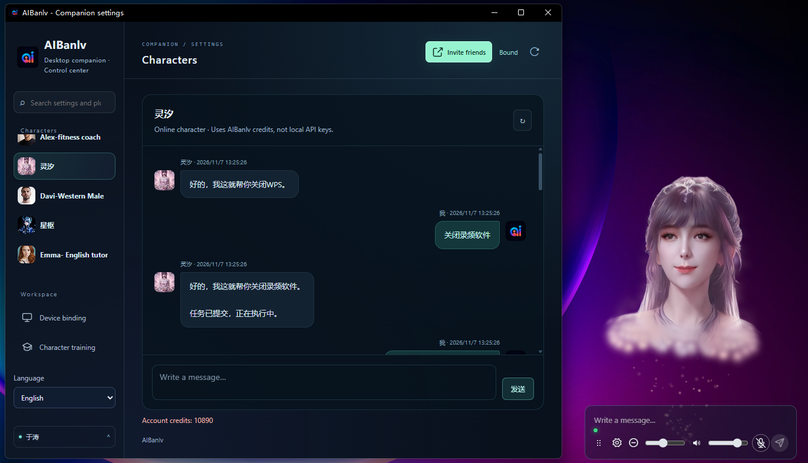
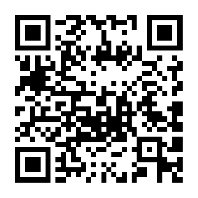
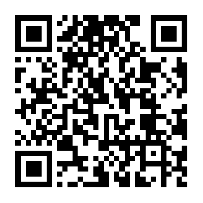
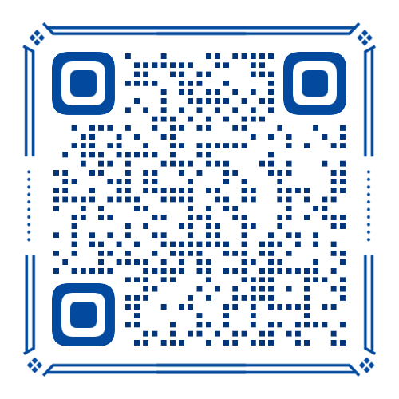

[简体中文](README.md) · [繁體中文](README.zh-Hant.md) · [English](README.en.md) · [日本語](README.ja.md)

# AIBanlv Bot

**姿があり、会話ができ、作業も手伝う AI デスクトップコンパニオン。**

音声やテキストで依頼すると、Harness が PC のツールや Codex / WorkBuddy を呼び出し、3D キャラクターが公開された進捗と結果をデスクトップへ届けます。仕事中は AI Agent の窓口に、ひと息つく時間は会話の相手に。

[Windows / Mac をダウンロード](https://aibanlv.ai/zh?view=desktop-companion) · [Bot の機能](#bot-の機能) · [動画デモ](#動画デモ) · [AI にインストールを依頼](#ai-にインストールを依頼) · [コミュニティ](#コミュニティ)

> プロジェクトの特長：専用 GPU 不要。表情豊かな 3D アバターをローカルでリアルタイム描画。



## Bot の機能

| 機能 | Bot に任せられること |
| --- | --- |
| **PC 操作** | 内蔵 Harness が検索、閲覧、PC のツールを呼び出してタスクを実行 |
| **Agent 連携** | インストール・ログイン済みの Codex / WorkBuddy に依頼し、公開された進捗と結果を確認。音声報告も選択可能 |
| **スマートフォンから操作** | App 連携後にリモートで依頼し、スクリーンショットや指定ファイルを連携済みのスマートフォンへ送信 |
| **3D 音声コンパニオン** | 透明なアバター、表情、リップシンクに加え、音声・テキスト・マウスで交流 |
| **キャラクターと記憶** | キャラクターをカスタマイズ。ローカルの人柄と記録を `SOUL.md`、`MEMORY.md`、日別対話文書に保存 |
| **リマインダーとメール** | 定時リマインダー、通知読み上げ、読み取り専用のメール確認。要約や本文抜粋の読み上げも選択可能 |
| AIアドバイザーチーム | 日々のやり取りをもとに、AI が自ら議論し解決策を見つける、能動型 AI アドバイザーシステム。 |

## ひと言の依頼から実行結果へ

1. **目標を伝える**：テキスト、音声、または連携済みのスマートフォンから依頼します。
2. **ツールを使う**：Harness がタスクを判断し、設定済みの PC ツールや外部 Agent に振り分けます。
3. **結果を受け取る**：アバター下のリアルタイム情報を確認し、必要に応じて進捗・完了報告を音声で聞けます。

```text
AI コンパニオン市場を調べ、要点と出典をまとめて。
Codex にこのプロジェクトのレビューを依頼して、終わったら結果を教えて。
今の画面を撮って、連携済みのスマートフォンに送って。
```

Harness は内蔵されています。[接続プラグイン](demos/web-desktop-pet/harness-client-plugin/README.md)でログイン済みの Harness クライアントも接続できます。Codex / WorkBuddy は別途インストールとログインが必要です。ツール実行やファイル送信は利用可能な機能と許可範囲に従い、非公開の推論は表示しません。[権限とローカルデータ](docs/CLIENT_SECURITY.md)を確認してください。

## 動画デモ

### タッチ操作による交流

https://github.com/user-attachments/assets/52426b81-48d8-462e-9196-fe106cceb57c

### 音声で PC を操作

https://github.com/user-attachments/assets/80ee7c5e-2ab5-46c9-b0d1-9954af03df63

## ダウンロード

ダウンロード後、キャラクターとモードを選び、必要な AI ツールを有効にしてください。ソースの初期設定は[共通インストールガイド](docs/INSTALL_FOR_AGENTS.md)（中国語）、Apple Silicon のソース用リソースは[完全環境ガイド](docs/MAC_SOURCE_BUNDLE.md)を参照してください。

| プラットフォーム | インストール |
| --- | --- |
| Windows x64 | [Windows インストーラー](https://aibanlv.ai/zh?view=desktop-companion) |
| Mac · Apple Silicon（M シリーズ） | [Mac インストーラー](https://aibanlv.ai/zh?view=desktop-companion) |
| Mac · Intel | 現時点では未対応 |

### モバイルアプリのダウンロード

<table>
  <tr><th>Apple iOS（ソースコード未公開）</th><th>Android（ソースコード未公開）</th></tr>
  <tr>
    <td align="center"></td>
    <td align="center"></td>
  </tr>
</table>

対象環境は Windows 10/11 x64 または macOS 13+ です。CPU に合うパッケージを選び、各リリースの要件・配布状況を確認してください。

Windows のソース初期設定では推論リソースを準備します。Apple Silicon の完全環境はネイティブ macOS 15+ が必要で、候補リソースは対象 Mac での検証が必要です。ダウンロード、検証、問題の切り分けは上のインストール文書にまとめています。

## AI にインストールを依頼

PC を操作できる Harness・Codex・WorkBuddy などの AI アシスタントへ、次を送ってください。

```text
https://github.com/AIBanlv/AIBanlv-Bot の AIBanlv をソースからインストールし、起動してください。
最初に docs/INSTALL_FOR_AGENTS.md を読み、OS と CPU を確認し、既存のソースがあれば再利用して手順に従ってください。
Mac では docs/MAC_SOURCE_BUNDLE.md も読み、マニフェストでリソースを検証し、対象 Mac 上で実際のセルフテストを行ってください。
利用中の Harness / Codex / WorkBuddy を接続し、既存設定を保持してください。インストールと検証が成功してから準備完了と報告してください。
ログイン、QR 連携、システム承認、Key 入力は私に任せてください。有料のテストタスクは作成せず、完了した手順と残りの設定を報告してください。
```

これは AI アシスタントへの依頼文であり、ターミナルのコマンドではありません。設定とシステムの許可はユーザーが確認します。

## 2 つの利用方法

| モード | 設定と費用 |
| --- | --- |
| **自分の Key・ローカルキャラクター** | Qwen Realtime Key は音声・音声複製、DeepSeek Key または接続済み Harness クライアントはテキスト・PC タスク用です。自分のプロバイダー利用枠を使い、AIBanlv ポイントは消費しません。QR 連携は不要です。 |
| **AIBanlv App・オンラインキャラクター** | 公開キャラクターはスキャン不要で本機の 800 ポイントのゲスト枠を利用でき、再インストールしてもリセットされません。QR 連携後、残りのゲスト枠をアカウントに一度だけ引き継ぎ、以後はアカウントのポイントを使用します。スマートフォン同期とクラウド保存も有効になります。 |

新しいローカルキャラクターには名前、キャラクター設定、利用許諾のある音声サンプルが必要です。LAM ZIP は任意で、読み込まない場合は現在のアバターのまま通常どおり会話できます。Key は OS 暗号化で保存でき、ローカルAIアドバイザーチームには自分の DeepSeek Key が必要です。ローカル保存はモデルのオフライン動作を意味せず、モデルと音声は設定したプロバイダーへ接続します。[データ境界の仕様](docs/local-companion-spec.md)を参照してください。

## データと権限

- 描画、ウィンドウ操作、口・表情の処理はローカルです。モデル、音声、同期、ダウンロードの通信は機能と設定に依存します。
- 連携モードは AIBanlv に接続します。モデルタスクは必要な情報を設定したプロバイダーへ渡します。スクリーンショット、ファイル、メールに含まれる個人情報に注意してください。
- メール連携は読み取り専用で、送信クライアントではありません。本文読み上げは個別に有効化し、対話ポイントを消費する場合があります。
- API Key、デバイス識別情報、非公開アバター、モデル重み、ログやインストーラーをリポジトリへコミットしないでください。ソース公開は外部サービスの無料化やユーザーデータの公開を意味しません。

## 開発

Windows のコマンドライン開発には Node.js 24+ と npm が必要です。以下でリポジトリをクローンし、そのディレクトリで実行します。Mac の初回設定は[共通インストールガイド](docs/INSTALL_FOR_AGENTS.md#macos)に従ってください。

```sh
git clone https://github.com/AIBanlv/AIBanlv-Bot.git
cd AIBanlv-Bot
npm ci
npm run setup
npm start
```

Windows の `npm run setup` は依存関係と Electron をインストールし、ローカルモデル、Python、JDK をダウンロードして検証します。**Setup AIBanlv.cmd** をダブルクリックすると、必要に応じて Node を準備し、**AIBanlv Source** デスクトップショートカットも作成します。起動後はキャラクターと会話の設定が必要です。[共通インストールガイド](docs/INSTALL_FOR_AGENTS.md)を参照してください。

```sh
npm test
```

- [開発・パッケージ・配布ガイド（簡体字中国語）](docs/DEVELOPMENT.md)：従来の README の環境設定、Windows パッケージ、R2 更新、問題の切り分けを保存。
- [Mac 環境とテスト](MAC-TEST.md) · [クロスプラットフォーム仕様](CROSS-PLATFORM-SPEC.md) · [Demo とテスト](demos/web-desktop-pet/README.md)
- [設定とプラグイン](docs/settings-plugins-spec.md) · [タスク実行](docs/semantic-tools-autoconnect.md) · [AIアドバイザーチーム](docs/ai-moments-spec.md)

Windows と macOS は共通のソースを使います。`android-native/` はデスクトップで共用するソースの一部で、ビルド可能な Android App ではありません。Issue、再現手順、PR を歓迎します。公開前に認証情報や非公開の会話を取り除いてください。

## コミュニティ

- **Discord**：[コミュニティに参加](https://discord.gg/9meHReRryZ)
- **WeChat コミュニティ**：下の QR コードを読み取って参加してください。
- [公式サイトと App](https://aibanlv.ai/zh) · [不具合を報告](https://github.com/AIBanlv/AIBanlv-Bot/issues)



## ライセンスと素材

独自のデスクトップソースは **[Apache-2.0 license](LICENSE)** で提供します。使用、変更、再配布に加え、商用利用とコピーの販売も可能です。配布する際にはライセンスと告知の保持、変更の明示などの条件を守る必要があります。[ライセンスと素材の説明](docs/LICENSING.md)を参照してください。

**AIBanlv のロゴ、商標、アプリアイコン、キャラクターと関連する映像・音声・モーション素材は、デスクトップソースのライセンスに含まれません。** 公開表示やダウンロード可能であることは、複製、再配布、販売の許可ではありません。別途権利者の許可を取得してください。**統合または参照する第三者のコード、依存ライブラリ、モデルの重み、データその他の素材には、それぞれのプロジェクトと個別素材のライセンス・利用条件が適用されます。** 本プロジェクトの Apache-2.0 はそれらの権利を置き換えたり拡張したりしません。配布前に使用するバージョンの上流 LICENSE/NOTICE とモデルの条件を確認してください。詳細は[第三者への謝辞](THIRD_PARTY_NOTICES.md)を参照してください。

## 謝辞・引用

アバター作成、音声駆動の表情、意味に沿った顔のキーフレームを支える研究とオープンソースに感謝します。

- [LAM](https://github.com/aigc3d/LAM)：1 枚の画像からアニメーション可能な Gaussian head を生成する研究。
- [DeepSeek Harness](https://github.com/deepseek-ai/deepseek-harness)：組み込みのタスク振り分けと制限付きデスクトップツールを支えるエージェント実行基盤。
- [LAM Audio2Expression](https://github.com/aigc3d/LAM_Audio2Expression)：本アプリのリップシンク処理に関連する音声から表情への技術。
- [KeyframeFace](https://github.com/wjc12345123/KeyframeFace)：言語駆動の表情キーフレーム研究と形式の参考。本アプリが生成モデルを標準で実行するという意味ではありません。

上流リンク、ライセンス、論文引用、素材の範囲は[第三者への謝辞](THIRD_PARTY_NOTICES.md)を参照してください。本プロジェクトは、各研究チーム、DeepSeek、OpenAI、WorkBuddy の公式製品ではなく、提携・推奨を表すものでもありません。

## コミュニティへの参加

[Code of conduct · 行動規範](CODE_OF_CONDUCT.md) · [Contributing · 貢献ガイド](CONTRIBUTING.md) · [Security · セキュリティ](SECURITY.md)

コミュニティ・セキュリティ窓口：[frank750166@gmail.com](mailto:frank750166@gmail.com)。脆弱性の詳細、認証情報、個人データを公開 Issue に投稿しないでください。
