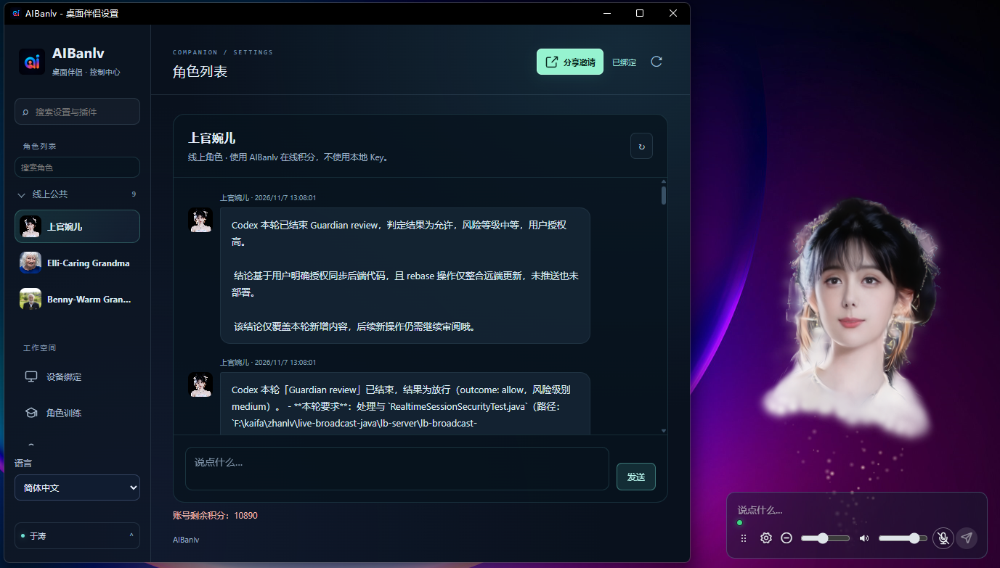

[简体中文](README.md) · [繁體中文](README.zh-Hant.md) · [English](README.en.md) · [日本語](README.ja.md)

# AIBanlv Bot

**有形象、能对话、会干活的 AI 桌面伴侣。**

用一句话下达任务，让 Harness 调用电脑工具、调度 Codex / WorkBuddy，再由数字人把公开进展和结果带回你的桌面。工作时是 AI Agent 的交互入口，闲下来也能陪你聊天。

[下载 Windows / Mac](https://aibanlv.ai/zh?view=desktop-companion) · [Bot 能力](#bot-能力) · [视频演示](#视频演示) · [让 AI 帮你安装](#让-ai-帮你安装) · [社群](#加入社群)

> 项目亮点：本地实时渲染无需独立显卡，带表情的 3D 数字人Bot。



## Bot 能力

| 能力 | 让 Bot 帮你做什么 |
| --- | --- |
| **电脑操作** | 内置 Harness 统一调度，搜索、阅读与本机操作，让任务进入真实工具执行 |
| **Agent 协作** | 向已安装并登录的 Codex / WorkBuddy 分配任务，跟踪公开进度与结果，可选语音汇报 |
| **手机遥控** | App 绑定后远程下达任务，发送截图或指定文件到绑定手机 |
| **3D 语音陪伴** | 透明桌面形象、表情与口型，支持语音、文字和鼠标触控互动 |
| **角色与记忆** | 自定义角色；本地角色用 `SOUL.md`、`MEMORY.md` 和每日对话文档保存人设与记录 |
| **提醒与邮箱** | 定时提醒、通知播报、只读邮件检查，可选摘要与正文节选播报 |
| AI智囊团 | 主动式 AI 顾问系统，根据日常互动内容，AI主动讨论并找到解决方案 |

## 从一句话到执行结果

1. **说出目标**：用文字、语音，或从绑定手机发送任务。
2. **调用工具**：Harness 识别任务并调度已配置的电脑工具或外部 Agent。
3. **跟进结果**：在数字人下方查看实时信息，按需收听进展与完成汇报。

```text
搜索 AI 伴侣的市场资料，整理要点和来源。
让 Codex 检查这个项目，完成后告诉我结果。
截一张当前屏幕，发给我绑定的手机。
```

Harness 已内置，也可通过[连接插件](demos/web-desktop-pet/harness-client-plugin/README.md)关联已登录的 Harness 客户端；Codex、WorkBuddy 需另行安装并登录。工具执行与文件发送受当前能力和授权范围限制，只展示公开进展与结果，不展示隐藏推理。详见[权限与数据说明](docs/CLIENT_SECURITY.md)。

## 视频演示

### 触控互动

https://github.com/user-attachments/assets/52426b81-48d8-462e-9196-fe106cceb57c

### 语音控制电脑

https://github.com/user-attachments/assets/80ee7c5e-2ab5-46c9-b0d1-9954af03df63


## 下载与安装

下载后选择角色和使用模式，再开启需要的 AI 工具。源码安装与首次配置见[安装与首次使用](docs/INSTALL_FOR_AGENTS.md)，Apple Silicon 源码运行资源见[完整环境指南](docs/MAC_SOURCE_BUNDLE.md)。

| 平台 | 安装入口 |
| --- | --- |
| Windows x64 | [下载 Windows 安装包](https://aibanlv.ai/zh?view=desktop-companion) |
| Mac · Apple Silicon（M 系列） | [下载 Mac 安装包](https://aibanlv.ai/zh?view=desktop-companion) |
| Mac · Intel | 暂未适配 |

### 手机 App 下载

<table>
  <tr><th>苹果 iOS（暂未开源）</th><th>安卓 Android（暂未开源）</th></tr>
  <tr>
    <td align="center"></td>
    <td align="center"></td>
  </tr>
</table>

运行环境：Windows 10/11 x64 或 macOS 13+。请选择匹配 CPU 架构的版本，安装包可用性、版本和系统要求以对应发行说明为准。

Windows 源码初始化会准备推理资源；Apple Silicon 源码完整环境要求原生 macOS 15+，候选资源需在目标机器通过自检。下载、校验与故障处理统一维护在上面的安装文档中。

## 让 AI 帮你安装

把下面这段话发给能操作本机的 AI 助手，例如 Harness、Codex 或 WorkBuddy：

```text
帮我从源码安装并启动 AIBanlv 桌面伴侣：https://github.com/AIBanlv/AIBanlv-Bot
先阅读仓库的 docs/INSTALL_FOR_AGENTS.md，识别系统和 CPU 架构，复用已有源码目录，按说明执行。
Mac 同时阅读 docs/MAC_SOURCE_BUNDLE.md，按清单校验资源，并完成目标机器的真实自检。
关联我正在使用的 Harness / Codex / WorkBuddy，保留已有配置，等待安装与检查成功后再报告就绪。
登录、扫码、系统授权和 Key 输入由我操作，不创建付费测试任务；结束时说明已完成步骤和待配置项。
```

这是交给 AI 助手执行的安装请求，不是终端命令；配置与系统授权仍由你确认。

## 两种使用方式

| 方式 | 配置与费用 |
| --- | --- |
| **自备 Key · 本地角色** | Qwen Realtime Key 用于语音与声音复刻；DeepSeek Key 或已连接的 Harness 客户端用于文字和电脑任务。使用自己的模型额度，不消耗 AIBanlv 积分，无需扫码。 |
| **AIBanlv App · 线上角色** | 公共角色可免扫码使用本机 800 分游客额度，重装不会重置；扫码后按账号一次性领取游客剩余额度并使用账号积分，同时启用手机同步与云端保存。 |

新增本地角色需提供名称、提示词和合法授权的声音文件；LAM ZIP 可选，不导入时沿用当前数字人形象，不影响对话。Key 可选择在本机加密保存。本地智囊团仍需自己的 DeepSeek Key。“本地”不代表模型断网可用：模型与语音仍访问所配置的服务商。详见[模式与数据边界](docs/local-companion-spec.md)。

## 数据与权限

- 桌面渲染、窗口交互与口型/表情处理在本机运行；模型推理、语音、同步和资源下载是否联网，取决于功能与配置。
- 当前线上模式会连接 AIBanlv 服务；模型任务会将必要内容发送给所选模型服务商。截图、文件和邮件内容可能包含隐私，启用前请阅读设置说明。
- 邮箱为只读集成，不代替发信客户端；正文播报需单独开启，可能使用对话积分。
- API Key、设备身份、私人形象、模型权重、运行日志与安装包不得提交到仓库。开源桌面代码不意味着第三方服务免费或用户数据公开。

任务授权、明文资料位置、截图去向和实际清理步骤见[源码端权限与本地数据说明](docs/CLIENT_SECURITY.md)。

## 参与开发

需要 Node.js 24+、npm 与 Git。Mac 首次运行按[安装说明](docs/INSTALL_FOR_AGENTS.md#macos)准备推理环境。

```sh
git clone https://github.com/AIBanlv/AIBanlv-Bot.git
cd AIBanlv-Bot
npm ci
npm run setup
npm start
```

Windows 也可双击 **Setup AIBanlv.cmd** 初始化，再从 **AIBanlv Source** 桌面快捷方式启动。真实模型调用按账号或自备 Key 的服务规则计费。

```sh
npm test
```

- [开发、构建与发布指南](docs/DEVELOPMENT.md) · [源码运行环境](docs/source-runtime-guide.md) · [源码更新](docs/source-update-spec.md)
- [Mac 环境与测试](MAC-TEST.md) · [跨平台约定](CROSS-PLATFORM-SPEC.md) · [Demo 与测试](demos/web-desktop-pet/README.md)
- [设置与插件](docs/settings-plugins-spec.md) · [任务调度](docs/semantic-tools-autoconnect.md) · [AI智囊团](docs/ai-moments-spec.md)

本仓库是 Windows/macOS 共用源码；`android-native/` 是桌面复用的源码子集，不是可直接构建的 Android App。欢迎提交 Issue、复现步骤和 PR；不要在公开反馈中粘贴 Key 或私人对话。

## 加入社群

- **Discord**：[加入社群](https://discord.gg/9meHReRryZ)
- **微信社群**：扫描下方二维码加入。
- [官网与 App](https://aibanlv.ai/zh) · [反馈问题](https://github.com/AIBanlv/AIBanlv-Bot/issues)


## 代码许可与资源边界

本仓库的原创桌面源码以 **[Apache-2.0 license](LICENSE)** 提供：允许使用、修改、再分发和商业使用；分发时须遵守保留许可与声明、标注修改等条件。详见[许可与资源说明](docs/LICENSING.md)。

AIBanlv 的 **Logo、商标、应用图标、人物形象和相关音视频/动作资产不随桌面源码获得授权**；公开展示或可下载不等于允许复制、再分发或商业售卖，需另行取得权利人许可。**集成或引用的第三方代码、依赖、模型权重、数据及其他资源，分别适用各自项目及具体资源的许可证或使用条款**；本项目的 Apache-2.0 声明不替代、不扩大这些授权。分发前请核对相应版本的上游 LICENSE/NOTICE 与模型许可，详见[第三方致谢](THIRD_PARTY_NOTICES.md)。

## 致谢与引用

感谢以下研究与开源项目，为数字人生成、音频驱动表情及语义关键帧提供基础：

- [LAM](https://github.com/aigc3d/LAM)：单图可动画高斯头部研究。
- [DeepSeek Harness](https://github.com/deepseek-ai/deepseek-harness)：本项目内置任务路由与受限电脑工具的智能体运行基础。
- [LAM Audio2Expression](https://github.com/aigc3d/LAM_Audio2Expression)：音频到表情，本项目口型推理链路的相关基础。
- [KeyframeFace](https://github.com/wjc12345123/KeyframeFace)：语言驱动表情关键帧研究与格式参考；不等于桌面端默认加载其生成模型。

上游项目链接、许可、论文引用和资源边界见[第三方致谢](THIRD_PARTY_NOTICES.md)。本项目与上述团队、DeepSeek、OpenAI、WorkBuddy 无官方隶属或背书关系。

## 社区协作

[Code of conduct · 行为准则](CODE_OF_CONDUCT.md) · [Contributing · 贡献指南](CONTRIBUTING.md) · [Security · 安全政策](SECURITY.md)

社区与安全联系：[frank750166@gmail.com](mailto:frank750166@gmail.com)。请勿在公开 Issue 中披露漏洞细节、密钥或私人数据。
