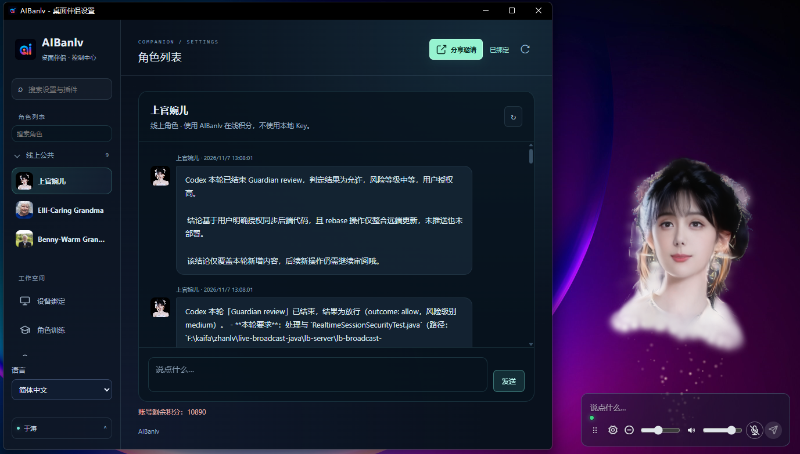

[简体中文](README.md) · [繁體中文](README.zh-Hant.md) · [English](README.en.md) · [日本語](README.ja.md)

# AIBanlv Bot

**有形象、能對話、會做事的 AI 桌面伴侶。**

用一句話下達任務，讓 Harness 呼叫電腦工具、調度 Codex / WorkBuddy，再由數位人把公開進度與結果帶回桌面。工作時是 AI Agent 的互動入口，空閒時也能陪你聊天。

[下載 Windows / Mac](https://aibanlv.ai/zh?view=desktop-companion) · [Bot 能力](#bot-能力) · [影片示範](#影片示範) · [讓 AI 協助安裝](#讓-ai-協助安裝) · [社群](#加入社群)

> 專案亮點：無需獨立顯示卡，具備表情的 3D 數位人在本機即時渲染。



## Bot 能力

| 能力 | 讓 Bot 幫你做什麼 |
| --- | --- |
| **電腦操作** | 內建 Harness 統一調度搜尋、閱讀與本機工具，讓任務進入實際執行 |
| **Agent 協作** | 向已安裝並登入的 Codex / WorkBuddy 分配任務，追蹤公開進度與結果，可選語音回報 |
| **手機遙控** | App 綁定後遠端下達任務，傳送截圖或指定檔案至綁定手機 |
| **3D 語音陪伴** | 透明桌面形象、表情與嘴型，支援語音、文字及滑鼠觸控互動 |
| **角色與記憶** | 自訂角色；本機角色透過 `SOUL.md`、`MEMORY.md` 與每日對話文件保存人設和記錄 |
| **提醒與郵件** | 定時提醒、通知播報與唯讀郵件檢查，可選摘要及內文節選播報 |
| AI智囊團 | 主動式 AI 顧問系統，根據日常互動內容，AI 主動討論並找到解決方案 |

## 從一句話到執行結果

1. **說出目標**：使用文字、語音，或從綁定手機傳送任務。
2. **呼叫工具**：Harness 辨識任務，調度已設定的電腦工具或外部 Agent。
3. **追蹤結果**：在數位人下方查看即時資訊，按需收聽進度與完成回報。

```text
搜尋 AI 伴侶的市場資料，整理重點與來源。
讓 Codex 檢查這個專案，完成後告訴我結果。
擷取目前螢幕，傳送到我綁定的手機。
```

Harness 已內建，也可透過[連線外掛](demos/web-desktop-pet/harness-client-plugin/README.md)關聯已登入的 Harness 客戶端；Codex、WorkBuddy 需另行安裝並登入。工具執行與檔案傳送受目前能力及授權範圍限制，只顯示公開進度與結果，不顯示隱藏推理。詳見[權限與資料說明](docs/CLIENT_SECURITY.md)。

## 影片示範

### 觸控互動

https://github.com/user-attachments/assets/52426b81-48d8-462e-9196-fe106cceb57c

### 語音控制電腦

https://github.com/user-attachments/assets/80ee7c5e-2ab5-46c9-b0d1-9954af03df63

## 下載與安裝

下載後選擇角色與使用模式，再啟用需要的 AI 工具。原始碼安裝與首次設定見[安裝與首次使用](docs/INSTALL_FOR_AGENTS.md)（簡體中文），Apple Silicon 原始碼資源見[完整環境指南](docs/MAC_SOURCE_BUNDLE.md)。

| 平台 | 安裝入口 |
| --- | --- |
| Windows x64 | [下載 Windows 安裝程式](https://aibanlv.ai/zh?view=desktop-companion) |
| Mac · Apple Silicon（M 系列） | [下載 Mac 安裝程式](https://aibanlv.ai/zh?view=desktop-companion) |
| Mac · Intel | 暫未適配 |

### 手機 App 下載

<table>
  <tr><th>蘋果 iOS（暫未開源）</th><th>安卓 Android（暫未開源）</th></tr>
  <tr>
    <td align="center"></td>
    <td align="center"></td>
  </tr>
</table>

執行環境：Windows 10/11 x64 或 macOS 13+。請選擇符合 CPU 架構的版本；可用版本、系統需求以各版本發行說明為準。

Windows 原始碼初始化會準備推理資源；Apple Silicon 原始碼完整環境需要原生 macOS 15+，候選資源須於目標機器通過自檢。下載、校驗及疑難排解步驟統一保留在上述安裝文件。

## 讓 AI 協助安裝

把以下內容傳給可操作本機的 AI 助手，例如 Harness、Codex 或 WorkBuddy：

```text
幫我從原始碼安裝並啟動 AIBanlv 桌面伴侶：https://github.com/AIBanlv/AIBanlv-Bot
先閱讀倉庫的 docs/INSTALL_FOR_AGENTS.md，辨識系統與 CPU 架構，沿用既有原始碼目錄，依說明執行。
Mac 同時閱讀 docs/MAC_SOURCE_BUNDLE.md，依清單校驗資源，並完成目標機器的真實自檢。
關聯我正在使用的 Harness / Codex / WorkBuddy，保留既有設定，等安裝與檢查成功後再回報就緒。
登入、掃碼、系統授權與 Key 輸入由我操作，不建立付費測試任務；結束時說明完成步驟與待設定項目。
```

這是交給 AI 助手執行的安裝請求，不是終端機命令；設定與系統授權仍由你確認。

## 兩種使用方式

| 方式 | 設定與費用 |
| --- | --- |
| **自備 Key · 本機角色** | Qwen Realtime Key 用於語音與聲音複製；DeepSeek Key 或已連線的 Harness 客戶端用於文字及電腦任務。使用自己的模型額度，不消耗 AIBanlv 點數，無須掃碼。 |
| **AIBanlv App · 線上角色** | 公共角色可免掃碼使用本機 800 分訪客額度，重裝不會重置；掃碼後按帳號一次性領取訪客剩餘額度並使用帳號點數，同時啟用手機同步及雲端保存。 |

新增本機角色需提供名稱、提示詞和合法授權的聲音檔案；LAM ZIP 為選填，未匯入時沿用目前的數位人形象，不影響對話。Key 可選擇在本機加密保存。本機智囊團仍需自己的 DeepSeek Key。「本機」不代表模型可斷網使用：模型與語音仍會連線至設定的服務商。詳見[模式與資料範圍](docs/local-companion-spec.md)。

## 資料與權限

- 桌面繪製、視窗互動與嘴型／表情處理在本機執行；模型、語音、同步與下載是否連網，取決於功能與設定。
- 目前線上模式會連線至 AIBanlv；模型任務會分享必要內容給指定服務商。截圖、檔案與郵件可能含私人資訊，啟用前請閱讀設定說明。
- 郵件為唯讀整合，不是寄信客戶端；內文播報需另外啟用，可能使用對話點數。
- API Key、設備身分、私人形象、模型權重、日誌與安裝程式不得提交到倉庫。桌面原始碼公開不代表第三方服務免費或使用者資料公開。

## 參與開發

Windows 命令列開發需要 Node.js 24+ 與 npm，以下先複製再進入倉庫執行。Mac 首次安裝請依[統一安裝說明](docs/INSTALL_FOR_AGENTS.md#macos)準備：

```sh
git clone https://github.com/AIBanlv/AIBanlv-Bot.git
cd AIBanlv-Bot
npm ci
npm run setup
npm start
```

Windows 的 `npm run setup` 會安裝相依套件與 Electron，再下載並校驗本機模型、Python 和 JDK。也可雙擊 **Setup AIBanlv.cmd**，按需準備 Node 並建立 **AIBanlv Source** 桌面捷徑。開啟程式後仍需設定角色與對話，詳見[統一安裝說明](docs/INSTALL_FOR_AGENTS.md)。

```sh
npm test
```

- [開發、建置與發布指南（簡體中文）](docs/DEVELOPMENT.md)：保留原 README 的環境、Windows 打包、R2 更新及疑難排解。
- [Mac 環境與測試](MAC-TEST.md) · [跨平台約定](CROSS-PLATFORM-SPEC.md) · [Demo 與測試](demos/web-desktop-pet/README.md)
- [設定與外掛](docs/settings-plugins-spec.md) · [任務調度](docs/semantic-tools-autoconnect.md) · [AI智囊團](docs/ai-moments-spec.md)

本倉庫為 Windows/macOS 共用原始碼；`android-native/` 是桌面複用的原始碼子集，不是可直接建置的 Android App。歡迎提供 Issue、重現步驟與 PR；公開回報前請移除金鑰與私人對話。

## 加入社群

- **Discord**：[加入社群](https://discord.gg/9meHReRryZ)
- **微信社群**：掃描下方 QR Code 加入。
- [官網與 App](https://aibanlv.ai/zh) · [回報問題](https://github.com/AIBanlv/AIBanlv-Bot/issues)


## 程式碼授權與資源範圍

本倉庫原創桌面原始碼以 **[Apache-2.0 license](LICENSE)** 提供，允許使用、修改、再散布，也允許商業使用及出售副本；散布時須遵守保留授權與聲明、標註修改等條件。詳見[授權與資源說明](docs/LICENSING.md)。

AIBanlv 的 **Logo、商標、應用程式圖示、人物形象及相關影音／動作資產不隨桌面原始碼取得授權**；公開展示或可下載不等於可複製、再散布或商業售賣，須另獲權利人許可。**整合或引用的第三方程式碼、相依套件、模型權重、資料及其他資源，分別適用各自專案與具體資源的授權或使用條款**；本專案的 Apache-2.0 聲明不取代也不擴大這些權利。發布前請核對相應版本的上游 LICENSE/NOTICE 與模型授權，詳見[第三方致謝](THIRD_PARTY_NOTICES.md)。

## 致謝與引用

感謝為數位人生成、音訊驅動表情與語義關鍵影格提供基礎的研究及開源專案：

- [LAM](https://github.com/aigc3d/LAM)：單圖可動畫高斯頭部研究。
- [DeepSeek Harness](https://github.com/deepseek-ai/deepseek-harness)：本專案內建任務路由與受限電腦工具的智慧體執行基礎。
- [LAM Audio2Expression](https://github.com/aigc3d/LAM_Audio2Expression)：音訊轉表情，與本專案嘴型推理鏈路相關。
- [KeyframeFace](https://github.com/wjc12345123/KeyframeFace)：語言驅動表情關鍵影格研究及格式參考；不代表桌面端預設載入其生成模型。

上游專案、授權、論文引用與資源範圍見[第三方致謝](THIRD_PARTY_NOTICES.md)。本專案與上述團隊、DeepSeek、OpenAI、WorkBuddy 無官方隸屬或背書關係。

## 社群協作

[Code of conduct · 行為準則](CODE_OF_CONDUCT.md) · [Contributing · 貢獻指南](CONTRIBUTING.md) · [Security · 安全政策](SECURITY.md)

社群與安全聯絡：[frank750166@gmail.com](mailto:frank750166@gmail.com)。請勿在公開 Issue 披露漏洞細節、金鑰或私人資料。
