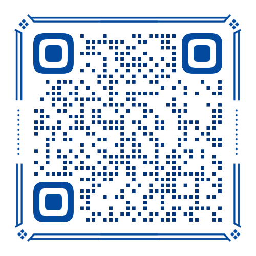

# 社群信息 / Community

以下社群入口已同步到四份 README。邀请链接和二维码由维护者提供；若失效，请在此处及四份 README 中一并更新。

| 联系方式 / Channel | 公开内容 / Public contact |
| --- | --- |
| Discord 邀请 / Invitation | [加入 Discord / Join Discord](https://discord.gg/9meHReRryZ) |
| 微信群二维码 / WeChat group QR code | [查看二维码 / View QR code](image/wechat.png) |

## 维护说明

1. 在 [简体中文](../README.md)、[繁體中文](../README.zh-Hant.md)、[English](../README.en.md)、[日本語](../README.ja.md) 的社群段落保持同一组入口。
2. Discord 只使用维护者允许公开传播的邀请链接；不要提交管理令牌或 Bot Token。
3. 微信群二维码保存在 `docs/image/wechat.png`；过期时替换图片并检查四份 README。不要附带私人聊天或手机号等额外信息。
4. 二维码不属于 Apache-2.0 代码授权，不因放入仓库而自动开放再分发权。

用户也可从[官网](https://aibanlv.ai/zh)了解产品，或在[仓库 Issues](https://github.com/AIBanlv/AIBanlv-Bot/issues)报告问题。
公开反馈请遮去 API Key、邮件授权码、设备身份、绑定二维码和私人对话。
